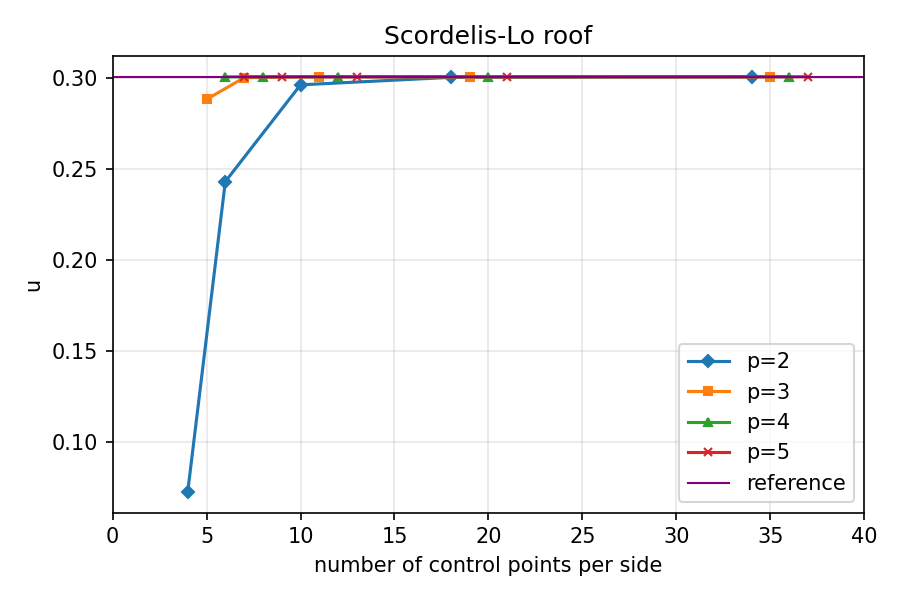
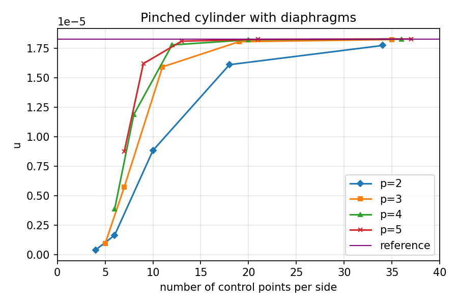
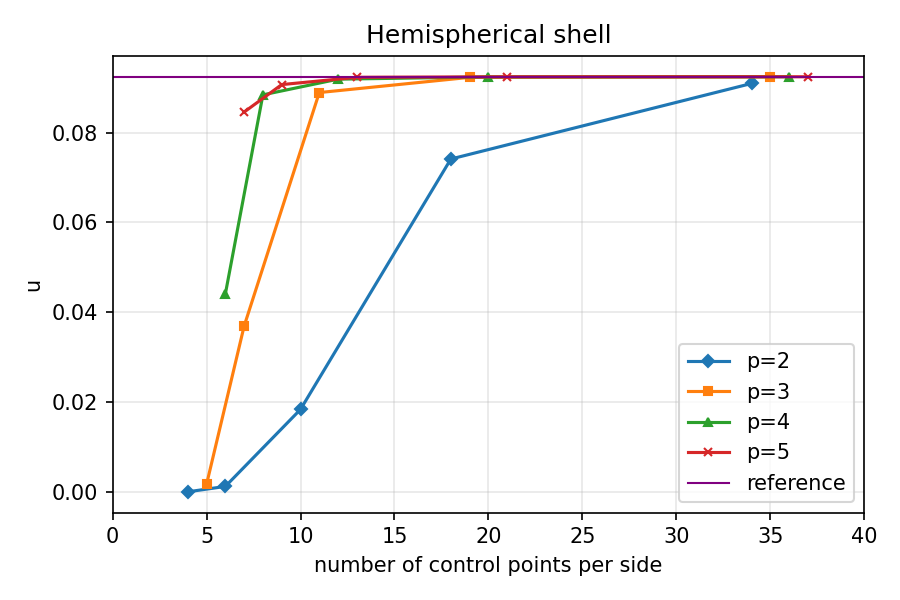
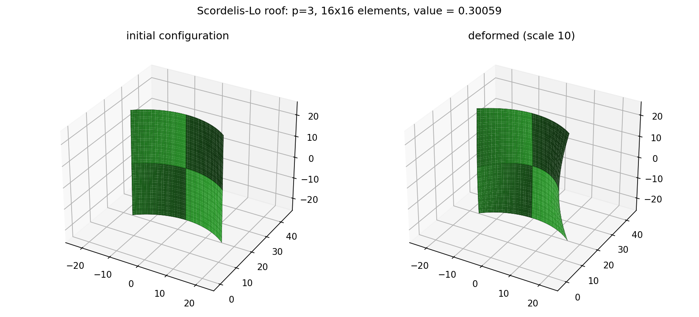
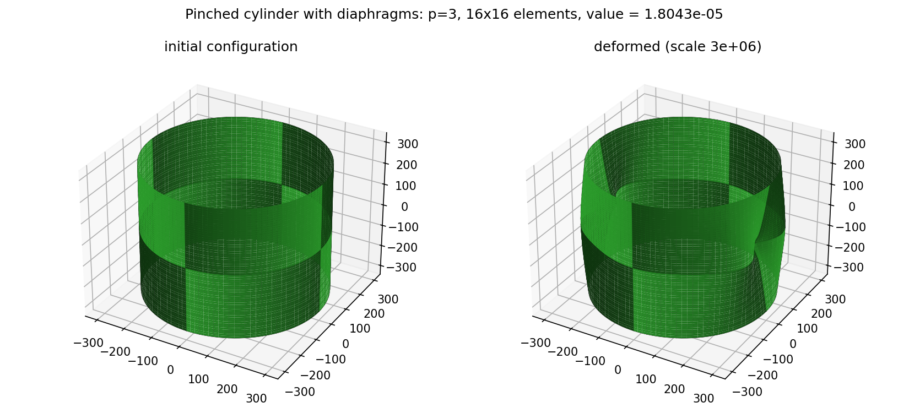
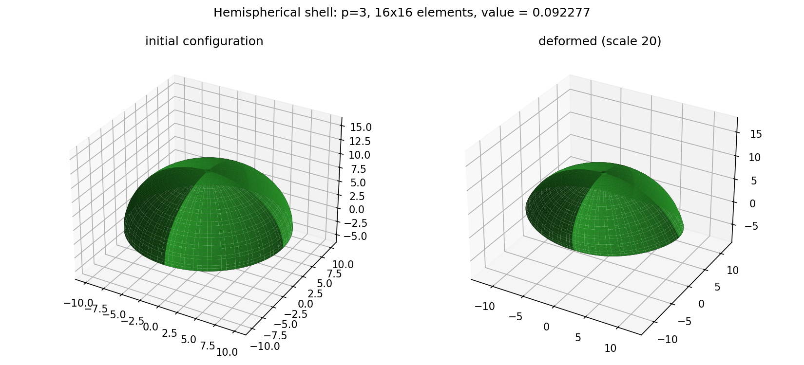
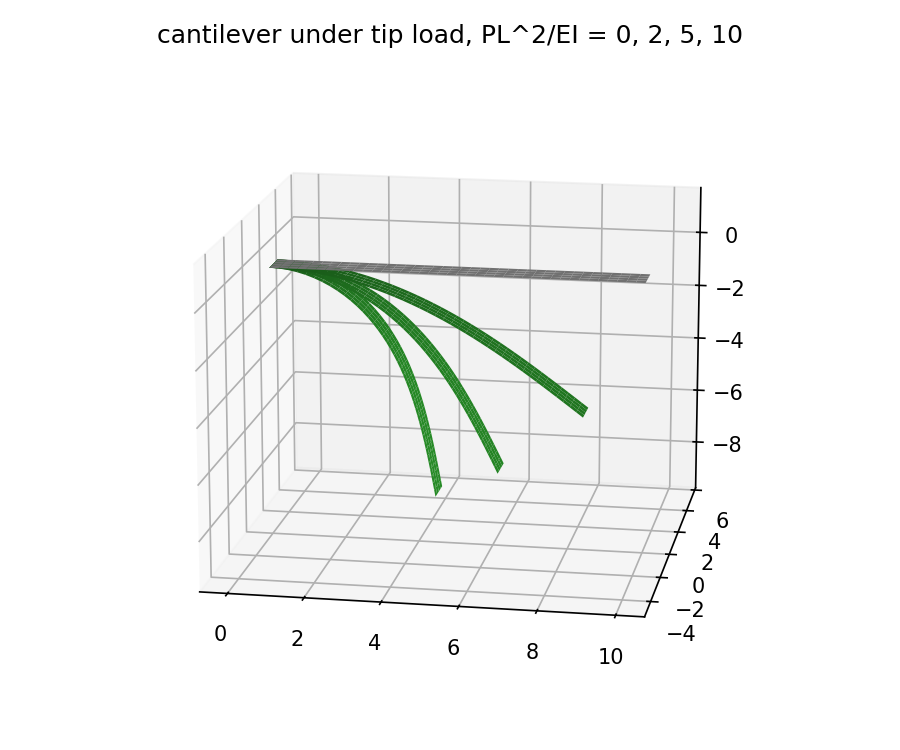

# Isogeometric Kirchhoff–Love shell solver

A from-scratch Python implementation of the rotation-free, NURBS-based Kirchhoff–Love shell
element of

> J. Kiendl, K.-U. Bletzinger, J. Linhard, R. Wüchner, *Isogeometric shell analysis with
> Kirchhoff–Love elements*, Comput. Methods Appl. Mech. Engrg. 198 (2009) 3902–3914.

Features: exact NURBS geometry (k-refinement: degree elevation then knot insertion), three
displacement DOFs per control point, St. Venant–Kirchhoff plane-stress material, geometrically
**linear** and **nonlinear** (total Lagrangian, consistent tangent, Newton–Raphson with load
stepping), displacement-based boundary conditions (clamps, rigid diaphragms, symmetry planes,
degenerate-pole coupling) and the complete *shell obstacle course* of Belytschko et al. (1985).

## Running

Requires Python 3.10+ with numpy, scipy, matplotlib, threadpoolctl and pytest:

```bash
pip install -r requirements.txt
python -m pytest tests -q                       # ~15 s, 40 tests
python benchmarks/run_obstacle_course.py        # p = 2..5, 2..32 elements/edge -> results/*.png, .csv
python benchmarks/plot_deformed.py              # deformed shapes (paper Figs. 14/15 style)
python benchmarks/cantilever.py                 # Sec. 4.1 linear beam + large-deflection tip load
```

## Obstacle course results

The three linear problems of the *shell obstacle course* (Belytschko et al., 1985) as set up in
Sec. 4.2 of Kiendl et al.: Scordelis–Lo roof under self-weight, pinched cylinder with rigid end
diaphragms, and the full hemispherical shell under four point loads. Each is modelled
on its symmetric quarter (one-eighth for the cylinder) with p = 2…5 and 2…32 elements per edge.

Quantity of interest at the finest quartic mesh (p = 4, 32×32 elements):

| Problem | this code | Kiendl et al. (converged) | Belytschko et al. (reference) |
|---|---|---|---|
| Scordelis–Lo roof, w at midpoint of free edge | 0.30059 | 0.3006 | 0.3024 |
| Pinched cylinder, u under load | 1.82637e-5 | 1.8264e-5 | 1.8248e-5 |
| Hemispherical shell, radial u at loads | 0.09241 | 0.0924 | 0.0924 |

Convergence with mesh refinement for all four degrees (plots follow the paper's Figs. 11–13):

**Scordelis–Lo roof: vertical displacement at the midpoint of the free edge (reference 0.3006)**

| elements/edge | p = 2 | p = 3 | p = 4 | p = 5 |
|---|---|---|---|---|
| 2×2 | 0.07243 | 0.28816 | 0.30056 | 0.30055 |
| 4×4 | 0.24295 | 0.30007 | 0.30058 | 0.30059 |
| 8×8 | 0.29615 | 0.30058 | 0.30059 | 0.30059 |
| 16×16 | 0.30026 | 0.30059 | 0.30059 | 0.30059 |
| 32×32 | 0.30056 | 0.30059 | 0.30059 | 0.30059 |



**Pinched cylinder: radial displacement under the load (reference 1.8264e-5)**

| elements/edge | p = 2 | p = 3 | p = 4 | p = 5 |
|---|---|---|---|---|
| 2×2 | 3.7844e-07 | 9.1018e-07 | 3.8520e-06 | 8.7135e-06 |
| 4×4 | 1.6407e-06 | 5.7034e-06 | 1.1864e-05 | 1.6186e-05 |
| 8×8 | 8.8201e-06 | 1.5909e-05 | 1.7772e-05 | 1.8092e-05 |
| 16×16 | 1.6095e-05 | 1.8043e-05 | 1.8206e-05 | 1.8244e-05 |
| 32×32 | 1.7724e-05 | 1.8231e-05 | 1.8264e-05 | 1.8273e-05 |



**Hemispherical shell: radial displacement at the loaded points (reference 0.0924)**

| elements/edge | p = 2 | p = 3 | p = 4 | p = 5 |
|---|---|---|---|---|
| 2×2 | 0.00004 | 0.00168 | 0.04403 | 0.08455 |
| 4×4 | 0.00124 | 0.03691 | 0.08839 | 0.09067 |
| 8×8 | 0.01838 | 0.08890 | 0.09188 | 0.09229 |
| 16×16 | 0.07411 | 0.09228 | 0.09238 | 0.09240 |
| 32×32 | 0.09092 | 0.09240 | 0.09241 | 0.09241 |



Compared with the p = 2 curves read off the paper's figures (Scordelis–Lo 0.077, 0.247, 0.296,
0.300, 0.300; pinched cylinder ~4e-7, 1.5e-6, 8.8e-6, 1.61e-5, 1.78e-5; hemisphere ~0, ~0.001,
0.019, 0.074, 0.0905) the agreement is within reading accuracy. As in the paper, quartic and
quintic bases are converged by the second refinement step. The whole course (60 analyses, up to
3885 DOFs) runs in about 30 s. Full table with DOF counts and timings: `results/obstacle_course.csv`.

Deformed shapes (p = 3, 16×16 elements, displacements scaled):

| Scordelis–Lo roof | Pinched cylinder | Hemispherical shell |
|---|---|---|
|  |  |  |

`tests/test_obstacle_course.py` asserts agreement with the paper's converged values to 0.5% and
with the p = 2 convergence curves read off Figs. 11–13.

Cantilever checks (`benchmarks/cantilever.py`): one cubic element reproduces `PL³/3EI` exactly
(Sec. 4.1); the geometrically nonlinear tip-load case matches Mattiasson's elliptic-integral
solution (w/L = 0.8106, u/L = 0.5550 at PL²/EI = 10) to four digits.



## Package layout

```
iga_kl/
  bspline.py      Cox–de Boor basis + derivatives, knot insertion, Bézier degree elevation, Gauss rules
  nurbs.py        NurbsSurface: rational basis (values, 1st, 2nd derivs), evaluation, k-refinement,
                  edge/corner control-point helpers
  geometry.py     exact arcs, cylinder segments, quarter hemisphere (surface of revolution), plates
  mesh.py         knot spans -> elements; basis values at Gauss points precomputed once
  material.py     curvilinear plane-stress matrix C^{abcd} = lam G^ab G^cd + mu (G^ac G^bd + G^ad G^bc)
  kinematics.py   G_a, G_3, metric, curvature; B-matrices (membrane, bending); geometric stiffness;
                  cancellation-free strain evaluation from displacement gradients
  element.py      element tangent / internal force / strain energy (total Lagrangian)
  assembly.py     COO -> CSR assembly
  constraints.py  union-find constraint builder (fixed DOFs + equality couplings) -> u = T u_hat + u_p;
                  clamp / rigid_diaphragm / symmetry / couple_pole helpers
  loads.py        body, pressure, point (any parametric location) and edge line loads
  solver.py       reduced linear solve, Newton–Raphson
  model.py        ShellModel convenience wrapper
  benchmarks.py   the three obstacle-course problems
  postprocess.py  sampling, 3-D plots, convergence plots
benchmarks/       command-line scripts
tests/            pytest suite (basis, geometry, kinematics, linear, nonlinear, obstacle course)
```
